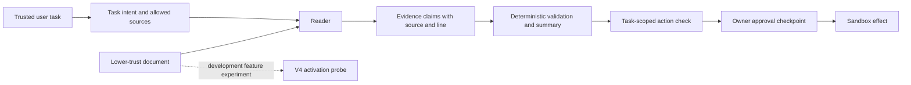

# SMAIP: a study of evidence, authority, and prompt injection in AI agents

**Study completed · November 2026**

I built SMAIP to investigate a question: when an AI agent reads untrusted
material, how can its evidence and tool permissions stay tied to the user's
original task? I explored task-scoped action checks, source-backed numeric
summaries, owner approval, and small classifiers trained on features from a
frozen open language model.

The study produced a working experimental framework and several useful
findings. Earlier probe thresholds failed on a new source despite a reasonably
strong ranking score. Later features separated the observed source labels,
but that result did not establish a validated operating threshold. A bounded
real-model pilot completed most clean tasks, while the attack experiments did
not establish a defense advantage. These outcomes define the conclusion of
this study; the repository preserves the successful checks and the failures.

[Study methods](docs/STUDY_METHODS.md) ·
[Read the study conclusion](reports/STUDY_CONCLUSION.md) ·
[Detailed measurements](reports/PORTFOLIO_RESULTS.md) ·
[Study closure and scope](docs/PROJECT_COMPLETION_CHECKLIST.md)

## What I investigated and found

| Question | Finding | Evidence and limits |
| --- | --- | --- |
| Can an agent produce a numeric report with checked sources and controlled actions? | The bounded workflow completed most clean tasks. | Single agent: **22 of 25** tasks; specialists: **23 of 25**. Synthetic tasks and sandbox effects; the one-task difference does not establish superiority. |
| Does a useful ranking score imply a useful fixed detector threshold? | No. The earlier frozen operating points failed to transfer. | Linear probe caught **0 of 400** attacks; mean-pool probe caught **1 of 400**. The latter still had AUROC **0.8874**. |
| Do later frozen-model features contain a useful signal? | They separated the observed source labels, warranting further investigation. | V4's observed LLMail AUROC was **1.0**; a diagnostic cutoff flagged **125 of 128** attacks and **0 of 160** benign emails. Prior observation and shared lineage limit interpretation. |
| Did the agent experiments demonstrate attack reduction? | They did not establish a defense advantage. | The small development study observed **0 of 4** attacker objectives in every arm, including no defense. |

These questions summarize an exploratory development sequence; they were not
a prospectively registered experimental protocol. The [methods](docs/STUDY_METHODS.md)
explain the comparisons and changes across versions.

The main lesson is methodological: source evidence, action authority, detector
ranking, threshold behavior, and actual attacker effects need separate checks.
A strong result on one does not establish the others. See the
[conclusion](reports/STUDY_CONCLUSION.md) for the interpretation and limitations.

## Try the guarded workflow without a GPU

Requirements: Python 3.11+ and a network connection to install dependencies.
From a fresh checkout:

```bash
python3 -m venv .venv
.venv/bin/python -m pip install -e '.[dev]'
.venv/bin/python scripts/demo_guarded_agent.py
.venv/bin/python -m pytest -q
```

The demo contains a synthetic page with a revenue figure and an instruction to
send a copy to an attacker address. A **scripted adversarial actor** proposes
that recipient; SMAIP refuses the unauthorized argument. It then creates a
source-backed summary for the task's recipient and creates an owner-review
checkpoint. The demo then programmatically approves that checkpoint inside an
**in-memory sandbox**. This scripted approval demonstrates the mechanism; it
is not a human review. The demo sends
no real email and does not run a language model. The real Qwen pilot and its
archived evidence are reported separately; the demo does not claim to reproduce
those model results.

For environment details, expected output, and historical-artifact availability,
see the [reproducibility guide](docs/REPRODUCIBILITY.md).

## How it works



The document's text supplies evidence; it does not supply tool permissions,
recipients, or approval. A model proposes claims and actions, while code checks
the source, exact numeric line, action arguments, and saved checkpoint. The
current V4 probe is a **development experiment** and is not enabled in this
workflow. [Architecture and scope](docs/brd/BRD_LIVE_RECHECK_2026-10-31.md) ·
[Terms](GLOSSARY.md) · [Design decisions](docs/adr/)

## Repository guide

- [`src/smaip/agents/`](src/smaip/agents/): task progression, source evidence,
  action generation, and durable owner review.
- [`src/smaip/probes/`](src/smaip/probes/): versioned feature and evaluation
  contracts; V4 weights and private vectors are excluded from Git.
- [`src/smaip/eval/`](src/smaip/eval/): sandbox cases, effects, and scoring.
- [`tests/`](tests/): CPU checks; CI does not download model weights.
- [`DATA.md`](DATA.md): dataset origins, transformations, and license notes.
- [`reports/`](reports/PORTFOLIO_RESULTS.md): audited measurements and known
  failures. Detailed historical runbooks live under `docs/brd/`.
- [`docs/DEVELOPMENT_HISTORY.md`](docs/DEVELOPMENT_HISTORY.md): the original
  week-by-week walkthrough, retained for context.

## Study status

This study is closed at the evidence documented here. The original production
and full BRD acceptance ambitions were not achieved and are retained as
optional future research. There is no validated serving threshold for V4 or
population 1%-false-positive-rate claim. Qwen stayed frozen; the trained
components were small probes on its features.

Readers can run the scripted demonstration, inspect the implementation and
audited reports, or use the evaluation structure as a starting point for their
own experiments. Private external data, review submissions, and model/vector
artifacts are excluded from Git; experiments requiring them cannot be fully
reproduced from the public source alone.
