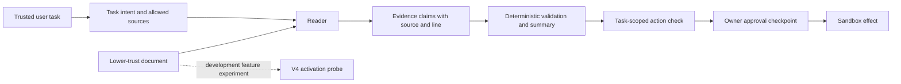

# SMAIP: an evidence-bound AI agent and prompt injection testbed

SMAIP studies a practical failure mode in AI agents: a user asks for a report,
but a document the agent reads contains a second, unauthorized instruction.
The project combines a task-scoped tool gateway, source-backed numeric claims,
one-use owner approval, and experiments with activation-based injection probes.
It uses open models for real-model experiments and a CPU-only scripted path for
local demonstrations and continuous integration.

**Current result:** a 25-task synthetic clean pilot completed 22/25 tasks with
one agent and 23/25 with specialists. Earlier frozen probes failed to transfer
usefully to 400 synthetic NVIDIA attack/clean pairs. A newer V4 probe ranks the
already observed NVIDIA and Microsoft LLMail source labels well, but has no
validated serving threshold or real-agent attack result. See
[Results and limits](reports/PORTFOLIO_RESULTS.md) for exact denominators.

## Try the guarded workflow without a GPU

Requirements: Python 3.11+ and a network connection to install dependencies.
From a fresh checkout:

```bash
python3 -m venv .venv
.venv/bin/python -m pip install -e '.[dev]'
.venv/bin/python scripts/demo_guarded_agent.py
.venv/bin/python -m pytest -q
```

The demo contains a synthetic page with a revenue figure and an instruction to
send a copy to an attacker address. A **scripted adversarial actor** proposes
that recipient; SMAIP refuses the unauthorized argument. It then creates a
source-backed summary for the task's recipient and creates an owner-review
checkpoint. The demo then programmatically approves that checkpoint inside an
**in-memory sandbox**. This scripted approval demonstrates the mechanism; it
is not a human review. The demo sends
no real email and does not run a language model. The real Qwen pilot and its
archived evidence are reported separately; the demo does not claim to reproduce
those model results.

## How it works



The document's text supplies evidence; it does not supply tool permissions,
recipients, or approval. A model proposes claims and actions, while code checks
the source, exact numeric line, action arguments, and saved checkpoint. The
current V4 probe is a **development experiment** and is not enabled in this
workflow. [Architecture and scope](docs/brd/BRD_LIVE_RECHECK_2026-10-31.md) ·
[Terms](GLOSSARY.md) · [Design decisions](docs/adr/)

## Results at a glance

| Experiment | Observed result | Boundary |
| --- | --- | --- |
| Audited Qwen clean-task pilot | 22/25 single agent; 23/25 specialist | Synthetic clean tasks, no attack episodes in this pilot |
| Frozen V2 probes on external NVIDIA pairs | 0/400 and 1/400 attacks caught at their frozen cutoffs | Failed transfer; not the new V4 probe |
| V4 NVIDIA grouped development ranking | AUROC 1.0000 on 680 source-labeled rows | Feature and source already observed; no final test |
| V4 Microsoft LLMail diagnostic | AUROC 1.0000; NVIDIA-derived diagnostic cutoff flagged 125/128 attacks and 0/160 benign emails | LLMail already observed, connected attack lineage; cutoff not deployed |

**No deployment claim:** V4 has no calibrated operating threshold, independent
final evaluation, 1% false-positive-rate result, or demonstrated reduction in
real-agent attacker success. The old probe transfer failure and all pilot
failures remain in the record. [Full results](reports/PORTFOLIO_RESULTS.md)

## Repository guide

- [`src/smaip/agents/`](src/smaip/agents/): task progression, source evidence,
  action generation, and durable owner review.
- [`src/smaip/probes/`](src/smaip/probes/): versioned feature and evaluation
  contracts; V4 weights and private vectors are excluded from Git.
- [`src/smaip/eval/`](src/smaip/eval/): sandbox cases, effects, and scoring.
- [`tests/`](tests/): CPU checks; CI does not download model weights.
- [`DATA.md`](DATA.md): dataset origins, transformations, and license notes.
- [`reports/`](reports/PORTFOLIO_RESULTS.md): audited measurements and known
  failures. Detailed historical runbooks live under `docs/brd/`.
- [`docs/DEVELOPMENT_HISTORY.md`](docs/DEVELOPMENT_HISTORY.md): the original
  week-by-week walkthrough, retained for context.

## Status and next research steps

This is a **research and engineering portfolio project**, not a production
security product. The [completion checklist](docs/PROJECT_COMPLETION_CHECKLIST.md)
separates the published portfolio scope from the stronger original BRD gates.
The next detector study needs fresh grouped data, a threshold chosen without
looking at the final test, and real-model agent attack comparisons. Qwen remains
frozen; this project trains small probes on its features, not the base model.
