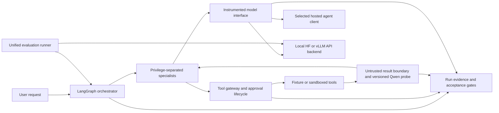

# SMAIP BRD alignment and completion roadmap

Assessment date: October 30, 2026, America/Chicago.

Source: [BRD: Secure Multi-Agent Inference Platform](https://brd-secure-multi-agent-inference-y62m.pages.grok.bot/), version 1.2 dated October 26, 2026. All 19 sections were read from the rendered page. Requirement IDs below are local traceability IDs added for this assessment; FR-1 through FR-4 and section numbers are the BRD's own structure. The source page was read without editing it. Prior-art assertions on the BRD page were not independently re-researched and are not accepted as proven novelty claims here.

## Subsequent owner decision and implementation

The owner clarified that the agent loop should also use an open-source model. That decision supersedes the old hosted-Codex selection in the source BRD. No OpenAI API credential is required for the chosen local HF/self-hosted vLLM path. The matrix below records the original audit; current implementation progress and outstanding acceptance work are in `OPEN_MODEL_V2_IMPLEMENTATION.md`. The v1 recovery/evidence is now preserved locally as commit `9d13c05`.

October 31 update: returned pilot 03 verified constrained Pydantic agent actions on the real A16 model, with four deliveries and remaining summary errors. The next measured step uses matched development controls and explicit quality/effect grading; see `OPEN_AGENT_DEVELOPMENT_RUN.md`. V2 probe training, independent low-FPR evidence and final BRD acceptance remain pending. References to a hosted client or unimplemented model loop below describe the original assessment, not the current owner-selected architecture.

## Position against the actual BRD

The repo has a substantial CPU-first engineering foundation plus real Week 7 frozen-Qwen probe training, repaired integration results and a verified numerical-parity diagnosis. It is **an experimental scaffold with measured components**, with important portions of the integrated portfolio product still missing.

The strongest completed work is API/gateway hygiene, a structured LangGraph fixture workflow, deterministic regression suites, keyword/encoding defenses, real probe artifacts, and preservation/validation of GPU evidence. The largest unfinished work is the hosted model-driven agent loop, live real-model inference serving, correctly defined structural ablations, low-FPR held-out evaluation, fair cost/performance measurement, and shipping artifacts.

The implementation is strongest in the Week 1–6 foundations and part of Week 7. Some Week 3–4 product behavior remains a mock, and Week 8's live integration, complete acceptance gates and public release are pending. Week labels are implementation milestones, not proof that all BRD requirements for those stages passed. A single percentage complete would hide these differences.

Checkout at the original assessment: `codex/week7-recovery`, based on `9233cf9429b896778735f809d8d049b33109a27e`; recovery changes were then uncommitted and unpushed. Current local checkpoints and status are in the update above. No publication or deployment was performed during this assessment.

## Requirements traceability

Status meanings: **Implemented** means locally implemented/tested within the stated scope; **Partial** means code or evidence exists but the BRD acceptance condition is not established; **Missing** means the required path/result was not found in this checkout; **Open** means the result is not met, cannot be inferred, or needs an explicit contract decision.

| ID | BRD requirement | Current evidence | Status / missing acceptance |
| --- | --- | --- | --- |
| A01 | §9 FR-1: chat API, health, metrics, cache | `src/smaip/serving/app.py`, `cache.py`, `metrics.py`; API tests | Implemented API shell; current compatibility is the implemented subset, not full OpenAI feature parity |
| A02 | §9 FR-1: real HF CPU engine and model/backend config | `serving/hf_cpu.py` implements opt-in 0.5B CPU generation; `engines.py` still maps `hf` to a stub and exposes a separate `hf-cpu` selector | Partial: prove the real backend through the deployed API/configuration surface and report backend provenance accurately |
| A03 | §9 FR-1, §17: real vLLM serving path | `serving/benchmark.py` runs vLLM offline; `VllmStubEngine` returns a fixed string | Partial: GPU benchmark exists; real vLLM generation is not wired into the chat API |
| A04 | §9 FR-2: orchestrator and least-privilege specialists | `agents/graph.py`, `planner.py`, `reader.py`, `actor.py`; roles, typed messages, source taint, field-bound actions | Implemented deterministic local-file fixture workflow; live read-only fetching and general model-driven planning/tool use are missing |
| A05 | §15/19: selected hosted agent model | `clients/codex.py:9` deliberately refuses every network call; analyst defaults to mock | Missing actual hosted-model agent loop and measured utility. The BRD's subscription/access wording is an integration assumption to verify before wiring a supported client |
| A06 | §9 FR-2, §11: one mediated tool boundary | `gateway/gateway.py`, schemas, role allowlists, approval tokens, audit protection | Implemented inside the local in-memory workspace; it is not a production email/files execution integration |
| A07 | §9 FR-3: train/integrate residual probes | Actual 3B CUDA probe artifacts; 57-record corpus; rescore and parity archives | Partial: real training and scoring work; independent low-FPR validation and a versioned consistent feature protocol are unfinished |
| A08 | §9 FR-3: tool-result-token features | `_render` wraps text as a user message; last pooling uses last nonpadding token; mean pooling includes all nonpadding template/system/content tokens | Partial: define and implement the intended tool-content context/token mask, or explicitly amend that requirement. Existing features are not a verified tool-result-only token pool |
| A09 | §11: flagged-action human confirmation | Gateway has trusted approval objects, but `Runtime.prepare` mints planned approvals internally; no user review/resume endpoint | Partial: enforcement tokens exist; user-facing flagged-action review/approval lifecycle is not implemented. Current refusal/quarantine remains useful |
| A10 | §9 FR-4, §12: comparable single-agent, least-privilege, probe, keyword, gateway, full-stack runs | Six named rows exist, but `LP-only` means linear probe and graph structure stays privileged even under no-defense | Missing BRD structural comparisons; current rows cannot isolate the contribution of least privilege |
| A11 | §5: multi-agent clean utility within five percentage points of single-agent | No comparable capable-model single-agent all-tools baseline in the repo | Missing measurement; perfect mock utility does not meet this acceptance criterion |
| A12 | §5/12: AUROC and TPR at 1% FPR, held-out families and sources | `TPR_TARGET=0.95`; threshold selection meets validation recall; current validation/test have five/four benign records | Missing BRD operating-point metric/protocol and adequately supported low-FPR claim |
| A13 | §9 FR-4, §12/13: real independent and adaptive attacks, external datasets/baselines | Original synthetic pages and scripted attack follower; external datasets only described in `DATA.md`; no adaptive experiment | Partial: fixture regression coverage is useful; benchmark adapters, independent family/source splits, adaptive tests and declared external defense comparisons remain |
| A14 | §5: full-stack lower ASR than keyword, structural least-privilege and probe-only | Current full-stack and both trained probe rows all have scripted ASR zero; gateway-only also zero | Open / not demonstrated. A tie cannot be reported as strictly better, and the structural LP-only row does not exist |
| A15 | §9 FR-4, §12: latency percentiles, TTFT, throughput, cache sweep, GPU cost | Original HF/vLLM GPU JSON ran; hardware now recorded by parity; benchmark percentile/count/fallback issues remain; no hourly-price cost model | Partial: replace prototype benchmark with repeated request-level measurements and a real USD-per-1k-token calculation |
| A16 | §10/12: observable traces, errors/tokens, approvals, unnecessary calls, utility under attack | Week 5/6 JSONL traces; basic counters; scenario JSON | Partial: Week 7 event traces are not persisted by `_measure`; reader message scores remain mock; token/approval/overhead and end-to-end model tracing are incomplete |
| A17 | §5/9 FR-4: one harness and executable quality/security/performance gates | CI and Week 1–6 gates exist; Week 7 CI is mock; rescore/parity emit reports without a model-quality acceptance gate | Partial: add versioned acceptance rules for actual probe/agent artifacts and performance; keep ordinary CI CPU-only |
| A18 | §11: PII before logs/model and output protection | Logging redaction exists; chat passes raw message content to `selected.complete`; no general secret/output check | Partial: implement/define the model-boundary PII policy and output canary/leak checks. Preserve authorized actor fields separately from model-visible redaction |
| A19 | §6/10/16: reproducibility, licensed data, architecture/threat docs, public artifact/demo | Make targets, Docker files, README invariants, `DATA.md`, `PRIOR_ART.md`, original evidence snapshots | Partial: formal BRD acceptance map/threat/architecture docs, upstream snapshot/license records for imported data, project license selection, final one-command path, demo video/write-up and public release remain |

Code references above describe the files inspected in this local state. The project’s prior-art files are context, not proof that upstream claims or license snapshots are current.

## Four corrections that materially change the next steps

### 1. Separate least privilege from linear probes

The BRD §12 requires a least-privilege-only comparison. `gateway/enforcement.py:3` explicitly defines LP-only as a linear probe; `lp_only():41` only enables `linear_probe`. Moreover, `agents/graph.py:172` checks the role tool allowlist independently of the enforcement preset, while planner/actor binding and integer extraction remain structural protections in every graph run.

Therefore the current no-defense row means selected gateway hooks are off, not that a single unrestricted model agent is being measured. Historical tables must retain their original meanings. Add a new versioned evaluation configuration with separate factors:

- topology: single agent versus privilege-separated multi-agent;
- keyword detector: off/on;
- learned detector: none, last-token, mean-pool, or explicitly defined combination;
- gateway policy: off/on, with all effects confined to the test workspace;
- model backend and frozen decoding settings.

Use unambiguous new labels such as `least-privilege-only`, `linear-probe-only`, `mean-probe-only` and `gateway-only`. A historical LP-only alias can remain for old reports but must never be relabeled as measured structural isolation. Do not weaken a running service simply to produce a baseline: use a dedicated sandboxed evaluation configuration.

### 2. Measure the BRD's low-FPR operating point

The BRD §5/12 asks for TPR at 1% FPR. The present `probes/logistic.py:11,140` instead chooses a threshold that catches at least 95% of validation positives, then reports FPR at that threshold. These are different operating-point questions. Existing `fpr_at_tpr` values are not TPR@1%FPR.

Define a calibration procedure on independent calibration groups that targets FPR <=1%, freeze it, then report achieved held-out TPR/FPR with counts and intervals. Also report a descriptive held-out ROC operating-point metric separately; do not tune a deployed threshold against final test labels. Both metrics may coexist with the old 95%-recall result if clearly labeled.

Five benign validation cases have 20-percentage-point FPR resolution; four benign test cases have 25-point resolution. These sets cannot substantiate 1% behavior. As a planning illustration, even with zero observed false positives, 299 independent benign examples are needed for the one-sided exact 95% upper bound to fall below 1% (`1 - 0.05**(1/n) <= 0.01`). Related templated examples do not become independent merely by increasing row count. Plan hundreds or more independent benign cases plus sufficient held-out attack cases and family/source coverage; this is an assessment recommendation, not a dataset-size requirement specified in the BRD.

### 3. Connect the live product loop

`clients/codex.py` raises `NetworkRefused`; `agents/analyst.py:45` uses a mock by default and only sees allowlisted integer digests; `serving/app.py:248` calls the local graph directly. This is good enforcement scaffolding but does not establish capable-model vendor research, tool planning or attack susceptibility.

A bounded hosted agent integration should retain the reader/analyst/actor/gateway boundaries and fixture tools, but produce actual structured model decisions/drafts through a recorded model interface. Validate that attacks can succeed in a dedicated undefended sandbox baseline before treating blocked attacks as measured model resistance. Record clean task utility, legitimate utility during attacks and proposed/accepted/refused tool actions. Keep deterministic regression tests alongside that experiment.

The BRD mentions both a hosted agent model and local open-model generations. Make the routing contract explicit: a common instrumented model gateway can route agent decisions to the selected hosted client and local completions to HF/vLLM. Record which backend generated every result. The BRD does not establish API access or entitlement by itself; verify the actual supported client/model setup before integration.

The 3B Qwen detector is separate from the generative agent model. It should not be presented as the model that generated the current mock agent decisions. The standalone vLLM benchmark is also separate from the live API until wired through a real engine adapter.

### 4. Prove joint value without manufacturing a win

Current real rescore: mean pooling, linear and full-stack all report zero scripted ASR; gateway-only also reports zero. Full-stack also retains the linear Cedar false positive. This does not meet the strict full-stack-superiority criterion. The separate caller is scripted; the graph itself remains uncompromised in every ablation.

Use comparable model-driven baselines and difficult independent/adaptive cases. Measure whether combinations improve safety at acceptable utility/cost. If layers remain redundant or full-stack trades extra false positives for no measurable ASR gain, report it. Keep the BRD criterion open or explicitly revise it with the owner; never silently declare a tie a win or choose attacks solely to make the combined row look best.

## What the GPU work established

The A16 run trained actual last-token and mean-pooled logistic probes over frozen 3B features. Original test AUROC was 1.0 for both on ten test records. After the document-scoring repair, Week 5 clean utility is 100% for both probes/full-stack; Week 6 mean pooling is 100%, while linear/full-stack is 87.5% with one false positive. The parity diagnostic verified 342 vector rows/684 scores and isolated the calibration mismatch to batch-four features versus single-document features; repeats were exact in those runs.

These are valuable component/integration results. They do not supply the missing single-agent baseline, independent family/source evaluation, TPR@1%FPR, real tool-result-token masking, hosted model behavior, or deployed vLLM cost story.

See `reports/WEEK7_RESCORE_ANALYSIS.md`, `reports/WEEK7_PARITY_ANALYSIS.md`, and the preserved run directories for the exact evidence. Last recorded full local suite: 168 passed, two optional HF checks skipped. This BRD assessment does not change engine code, probe files, thresholds or datasets and does not claim a new GPU experiment.

## Target integration contract

This is a proposed next implementation boundary, not a diagram of components already wired together:

The model boundary needs explicit backend routing, usage and timing, while action approval remains outside model-produced content. Real-world mail delivery is unnecessary for the locked draft-email demo; sandboxed sends or drafts provide measurable side effects without broadening product scope.

## Ordered implementation plan and exit criteria

### Phase A — Reconcile and preserve the contract (local)

1. Freeze the recovered v1 source/results in version control, keeping training, rescore and parity evidence separate.
2. Add BRD requirement IDs/acceptance tracking; introduce an evaluation schema version so old labels and results remain interpretable.
3. Specify independent topology/detector/gateway factors, a comparable single-agent baseline, 1%-FPR calibration policy and separate quality/security/performance budgets. The five-point clean-utility requirement and strict full-stack criterion remain explicit open acceptance checks.
4. Specify the hosted/local routing and tool-result feature context, pooling positions and versioned artifact contract.

Exit: every must-hit BRD criterion maps to a planned command, output and pass/fail rule. No claim depends on ambiguous LP labels or an unverified model-access assumption.

### Phase B — Build the real bounded product loop (local plus a small hosted-model pilot)

1. Implement the selected supported model client behind an injectable interface; retain mock tests and require explicit runtime configuration for paid calls. Do not store credentials in the repo.
2. Add real structured model decisions/drafts to the existing vendor research → summary → email-draft domain, preserving trusted action fields and gateway enforcement. Add an allowlisted read-only fetch adapter with bounded requests for the demo; retain offline fixtures for regression tests. A quarantined source must become a typed blocked result before the generative model consumes it; prefixing raw malicious content is not sufficient isolation for that new live path.
3. Implement single-agent all-tools versus privilege-separated topology with identical tasks, model and decoding budget in a dedicated evaluation sandbox.
4. Add user review/resume for flagged proposed actions where required; keep quarantine/refusal available. Record actual trained detector scores in traces rather than the reader's mock score.
5. Define model-input redaction and output/provenance checks, retaining authorized recipient/path bindings outside model-controlled arguments.

Exit: a clean request and poisoned-page request run through the actual configured agent model, with a complete proposed/accepted/refused tool trace. Both topologies are measurable; the undefended model baseline is empirically attack-susceptible for at least the attack cases on which resistance is claimed.

### Phase C — Correct the feature and data protocol (local before another GPU fit)

1. Use one shared extraction path for future fitting/calibration/serving. Batch-one is the verified starting point, not an assumed batched equivalence guarantee.
2. Define tool-content token spans and rendering. Current user-message/all-nonpadding pooling is a different feature definition; new weights must match the new protocol.
3. Version artifacts with base/tokenizer snapshot, dtype, rendering/mask/pooling, max length, truncation behavior and batching policy. Reject mismatched scoring configurations.
4. Build dataset v2 with corrected per-page versus per-episode labels, balanced lexical cues, clean hard negatives and group-level family/source splits. Preserve Ferry/Cedar as known development cases, not fresh test cases.
5. Add pinned external benchmark adapters and dataset/license manifests after checking actual upstream snapshots; keep data outside the repo where required. Include independent adaptive cases and predeclare learned-defense baseline comparisons.

Exit: frozen manifest, no group overlap, enough benign cases to assess low FPR, and a local dry run that writes every input/configuration hash without accessing the final test for tuning.

### Phase D — Run one planned GPU training/evaluation batch

1. Train the declared probe variants with the pinned feature protocol, independent calibration policy and recorded 1%-FPR operating point.
2. Save vectors/per-record scores so fitting and scoring can be audited without repeating GPU forwards.
3. Run independent family/source tests and adaptive cases; report counts, uncertainty and utility under attack. Compare the intended topology/detector/gateway configurations through the real bounded agent loop.
4. Fail the acceptance command when an agreed quality/security budget regresses; report an unmet BRD target honestly.

Exit: reproducible low-FPR probe and real-agent ablation report with explicit open/fail/pass statuses. This is a new result version, not a replacement of old v1 measurements.

### Phase E — Finish serving and the joint performance story

1. Wire actual local HF/vLLM generation through the inference API/backend contract and expose truthful health/backend/model metadata.
2. Run repeated request-level concurrency and cache-on/off experiments with matched prompts/output policies, warmup and explicit cache conditions.
3. Correct generated-token accounting, decoder padding, TTFT handling and percentile aggregation; never invent per-request latencies when timestamps are unavailable.
4. Configure the actual GPU hourly cost from the owner's rental bill and calculate infrastructure USD per 1,000 generated tokens: `hourly_USD * 1000 / (3600 * generated_tokens_per_second)`. State utilization, measurement window and whether input tokens/cache hits or hosted-model fees are included. Record those separately when denominators differ.
5. Measure full-stack defense overhead under the intended serving/batching protocol and emit a unified quality/security/performance report.

Exit: hardware/model/revision named; real p50/p95/TTFT, tokens/sec, cache impact and cost assumptions; single-agent/multi-agent quality comparison; regression budgets backed by measurements. Quantization is optional in functional scope and should follow a correct fp16 baseline rather than delay it.

### Phase F — Ship the portfolio artifact

Finalize architecture/threat-model documentation, limitations, citations, dataset manifests, project licensing, quickstart, GPU reproduction, verified results and a three-minute vendor-research injection demo. Prepare the public write-up only from supported numbers. Keep the repo private until the owner's results/release condition is satisfied; public release is not implied by reading this BRD.

Exit: reviewer can reproduce the mock path in one command, inspect the real evidence and understand what each layer contributes. Publish no unsupported resume claim about ASR gains or cost.

## Scope discipline

This plan stays inside the BRD's vendor-research draft-email use case. It does not add a SaaS platform, cluster, large-model fine-tuning, RL, voice, custom kernels or a production cloud rollout. Hosted-agent behavior and real local serving are existing BRD requirements, not new scope. External API usage and another GPU run should follow the prepared configuration and measurement protocol rather than an open-ended training loop.

Immediate priority: Phase A plus the shared feature protocol design from Phase C, then a small real-agent pilot. Another repetition of the old GPU command would not complete the missing BRD requirements.
